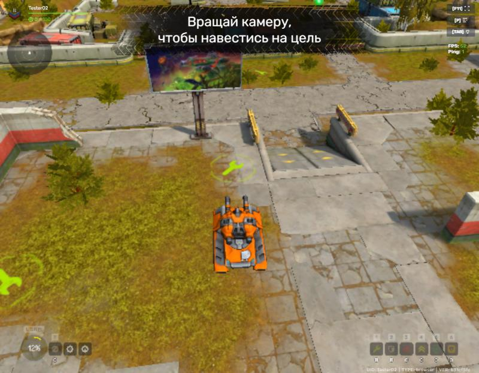

# Tanki 2026

Свой сервер для официального HTML5-клиента Tanki Online и заметки по устройству игры: протокол, вход,
регистрация, обучение, физика, оружие, ресурсы. Всё разобрано по коду клиента и записи трафика.

> Фанатский исследовательский проект. Не связан с Alternativa Games и Tanki Online.
> В репозитории нет файлов игры: клиент и ресурсы сервер при первом запуске скачивает с официального CDN
> на ваш компьютер.



## Что работает
Первая веха, проверено в браузере:
- регистрация: проверка ника и пароля, аккаунты хранятся локально (пароль — PBKDF2 с солью);
- конструктор танка: превью корпусов, пушек и красок;
- переход в обучающий бой: системное пространство, лобби, магазин, бой;
- танк появляется и ездит, клиент засчитывает первый этап обучения, пинг в интерфейсе настоящий.

Пока нет: мишеней, бонуса и ботов обучения, входа в существующий аккаунт, лобби и гаража после обучения,
настоящих боёв.

## Запуск
Нужны Python 3.10 или новее (проверено на 3.14) и интернет при первом запуске.
```bash
git clone https://github.com/slavadech91/tanki-2026.git
cd tanki-2026
pip install -r requirements.txt
python server/main.py
```
Откройте http://127.0.0.1:8100/play/ и зарегистрируйтесь: после конструктора танка начнётся обучающий бой.
- Первый проход до обучающего боя качает клиент со шрифтами (10 МБ) и ресурсы (около 47 МБ, 515 файлов) в папку
  `cache/`, дальше всё берётся оттуда. Другая папка для кэша — переменная окружения `TANKI_CACHE`.
- Порты: `python server/main.py 8100 9100` (HTTP и WebSocket). Сервер слушает только `127.0.0.1`.
- Аккаунты лежат в `server/data/accounts.json`. Входа в существующий аккаунт пока нет: чтобы пройти обучение
  ещё раз, зарегистрируйте новый ник.

## Как это устроено
- **HTTP** (8100): своя страница `server/play.html` запускает официальный клиент `main.289a5d50.js`,
  `config.xml` направляет его на наш WebSocket, файлы клиента и ресурсы раздаются из кэша.
- **WebSocket** (9100): управляющий сокет (рукопожатие без шифра, открытие пространств) и по сокету на
  каждое пространство: вход, системное, лобби, магазин, бой.
- Пакеты собирает кодек `tools/proto_codec.py` по схеме `server-notes/proto_schema.json`, извлечённой из
  клиента. Содержимое пространств (предметы, задания, тексты) — шаблоны `server/templates/`, вырезанные из
  записи трафика нового аккаунта; данные того аккаунта из них удалены. Ответы на действия игрока сервер
  строит сам.

Подробнее: [server/README.md](server/README.md). Заметки: [server-notes/README.md](server-notes/README.md).

## Что в репозитории
| папка | что внутри |
|---|---|
| `server/` | сервер (Python, aiohttp) |
| `server-notes/` | заметки и схема протокола |
| `tools/` | инструменты разбора: схема и кодек протокола, расшифровка записи трафика, поиск по коду клиента, модели `.a3d` → glTF |
| `tanki-viewer/` | просмотрщик моделей (сами модели не включены) |
| `MODLOG.md` | хронология работы |

Не публикуются: клиент и его статика, ресурсы игры (модели, текстуры, карты, звуки), записи трафика
(в них логин и пароль аккаунта), кэш сервера. В заметках на них ссылаются как на локальные папки
`tanki-src/`, `tanki-assets/`, `captures/`.

## Инструменты
После первого запуска сервера клиент лежит в `cache/static/js/main.289a5d50.js`, по нему работают
инструменты разбора:
```bash
python tools/js_find.py cache/static/js/main.289a5d50.js "rememberUsersHash" 300
python tools/proto_schema.py cache/static/js/main.289a5d50.js server-notes/proto_schema.json
python tools/a3d.py object.a3d model.glb
```
Описание и пример запуска — в начале каждого файла. Запись трафика (`tools/capture_ws.py`, нужен пакет
`websockets`) содержит логин и пароль вашего аккаунта открытым текстом: такие записи не публикуйте.

## Что дальше
1. ✅ Регистрация → конструктор танка → обучающий бой, танк ездит.
2. Обучение до конца: мишени, бонус, боты, выход в лобби.
3. Вход в аккаунт, лобби, гараж.
4. Свои бои: карты, режимы, урон, несколько игроков.

## Лицензия
Код и заметки — GPL-3.0, см. [LICENSE](LICENSE). Tanki Online, клиент игры, её ресурсы и торговые
марки принадлежат их владельцам, и эта лицензия на них не распространяется.

## In English
A fan-made server for the official Tanki Online HTML5 client, plus reverse-engineering notes on its protocol
(in Russian). Milestone 1 works: registration, tank builder, tutorial battle with a drivable tank. No game files
are included: on first run the server downloads the client and resources from the official CDN into a local
cache. Run it with `pip install -r requirements.txt` and `python server/main.py`, then open
http://127.0.0.1:8100/play/. Not affiliated with Alternativa Games. Code and notes are GPL-3.0.
